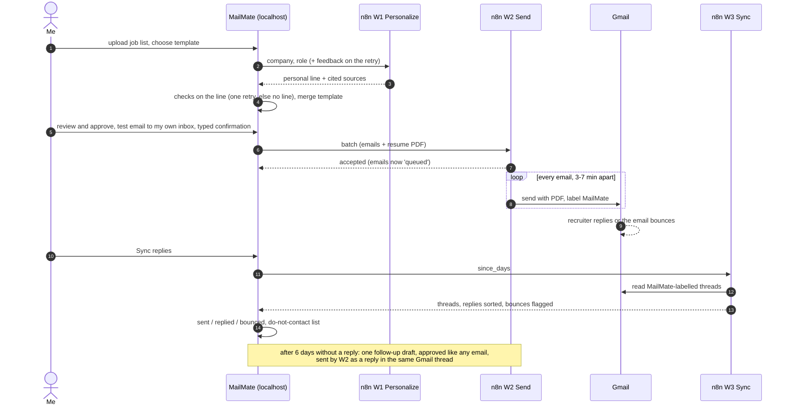
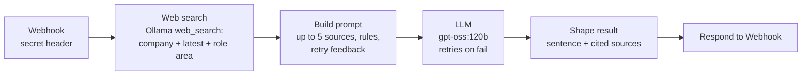
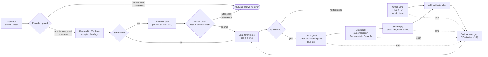
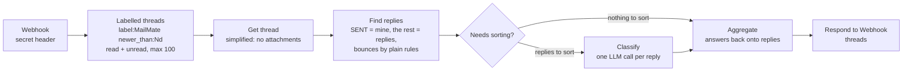
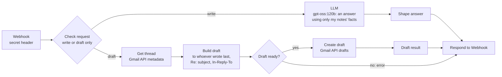
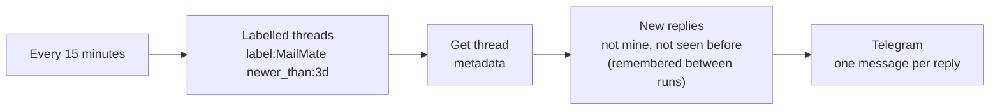

# MailMate

Recruiter outreach that is safe by design. I upload a list of jobs and recruiters; MailMate drafts
one email per recruiter from my template, with one short personal line about the company that a
model writes and plain code fact-checks; I approve every email; n8n sends them slowly from my Gmail
with my resume attached. MailMate then reads the replies, sorts them, keeps a do-not-contact list,
and offers at most one follow-up, again for my approval. For the answers I owe it suggests a reply
and saves it as a Gmail draft (I send it myself); a pipeline tracks each company from the first
reply to an offer; a watcher finds new AI openings at the companies I care about.

> **Nothing is sent without my approval.** Test emails go only to my own secondary inbox. Real
> sending has a daily cap, a weekday sending window, random spacing, one batch at a time and a
> typed confirmation. The app runs on this machine only.

## Rules that are never broken

1. No email goes out without my explicit approval of that email.
2. Every template version needs a test email to my own inbox, checked by me, before real sending.
3. Daily cap (default 20), weekdays 09:30-18:00 IST, 3-7 minutes between emails; a batch must
   finish inside the window, and batches never overlap. A batch can be scheduled for later (up to
   4 days ahead): every rule is checked for its start time, and W2 sends nothing if it would start
   more than 30 minutes late.
4. The model writes only the personal line. Code rejects it if it makes claims about me, names
   tools, contains facts not in the sources it cites, cites only job ads, is too long, contains
   placeholders or links, or doesn't say why the company makes me want to apply. One retry, then
   the email goes without a personal line.
5. Nobody is emailed twice (except the one follow-up). Bounces and "not interested" replies go on
   the do-not-contact list automatically.
6. One recruiter per company at a time: a company waits while its recruiter's email is queued, was
   sent less than 6 + 4 days ago without an answer, or their follow-up is drafted, queued or went out
   less than 4 days ago (the follow-up goes first, so two people at one company never get an email
   on the same day). It stays closed once someone there really answered. A bounce frees it at once.
7. Every email ends with an opt-out line.
8. Secrets live in `.env`, personal data in `data/`; both are git-ignored. Served on localhost only.
9. The n8n webhooks require a secret header.
10. Tests never touch the network, Gmail or a model.
11. MailMate never answers a recruiter by itself: W4 only saves a Gmail *draft*, which I send.

## How it fits together

```
Streamlit app (this laptop, localhost)                 SQLite: data/mailmate.db (+ data/backups/)
  home -> upload -> contacts -> templates -> review -> send -> replies -> pipeline -> dashboard
        |  HTTPS POST + header X-MailMate-Token   (laptop -> n8n only)
        v
n8n (Docker on this laptop, or Cloud)           stateless: keeps no data
  W1 MailMate-personalize   web search (Ollama) -> LLM writes one line + cited sources
  W2 MailMate-send          guard -> answer "accepted" -> (scheduled: wait until the start)
                            -> per email: Gmail send (+PDF, label) or reply in the first
                            email's thread (follow-up) -> random wait
  W3 MailMate-sync          labelled Gmail threads -> replies, bounces -> LLM sorts replies
  W4 MailMate-reply         LLM suggests an answer | answer -> Gmail DRAFT in the thread
  W5 Reply alerts           every 15 min: new replies in labelled threads -> Telegram
        |
        +-- Ollama Cloud API (web search + gpt-oss:120b)     +-- Gmail (OAuth)    +-- Telegram

The app also reads public job feeds directly (Greenhouse, Lever, Ashby, ...) for the openings watcher.
```

- n8n can't reach the laptop, so **MailMate keeps all data** and the workflows keep none.
- n8n's Wait node gives reliable throttling over hours, and holds scheduled batches; n8n must be
  running while a batch sends (see *Running n8n always on*).
- **Gmail is the record of what was sent:** every sent email gets the `MailMate` label; W3 reads
  labelled threads to learn which emails went out and who answered.

## Workflow architecture

### One email, end to end



### W1 Personalize (`POST /webhook/MailMate-personalize`)



Answer: `{sentence, sources: [{id, title, url, content}], model, search_ok}`. The source text comes back
so MailMate's checks can verify every name and number in the line against it.

### W2 Send (`POST /webhook/MailMate-send`, multipart: `payload` + `resume`)



The guard refuses the whole batch before anything is sent if: a test email isn't addressed to
`TEST_TO`, real sending is switched off, there are more than 20 emails, an email has no HTML body,
or there is no PDF, or a start time is more than 4 days ahead (or set on a test batch). It also puts
a floor under the spacing. A failure on one email (red error
paths) skips to the wait, so the rest of the batch still goes; W3 later shows which ones arrived.

### W3 Sync (`POST /webhook/MailMate-sync`)



Answer: `{threads: [{thread_id, sent_message_id, to, subject, sent_at, later_sent, replies: [{from,
date, snippet, category, confidence}]}]}`. The model can only choose `interview_request`,
`not_interested`, `auto_reply`, `question` or `other`; `bounce` comes from the rules alone. MailMate
decides what changes: matching threads to queued emails, statuses, the do-not-contact list.

### W4 Reply draft (`POST /webhook/MailMate-reply`)



`write` answers `{text, model}`: missing facts (times, dates, salary) become `[placeholders]`. `draft`
refuses text that still has a `[placeholder]`, and answers `{draft_id, to}`. W4 has no node that sends.

### W5 Reply alerts (schedule, no webhook)



The first run only remembers what is there, so old replies don't all arrive at once. Alerts carry the
sender, the subject and the first 300 characters (set `INCLUDE_SNIPPET = false` for sender and
subject only). It works only while published: n8n keeps "already seen" only for published workflows.

## Setup from scratch (Windows, PowerShell)

### 1. The app

```powershell
py install 3.11                         # Python install manager; or install Python 3.11 from python.org
py -V:3.11 -m venv .venv
.venv\Scripts\Activate.ps1
pip install -e ".[dev]"
copy .env.example .env                  # fill it in: step 3
pytest                                  # all tests should pass, offline
```

### 2. Gmail, n8n and the credentials

1. **Gmail:** create a label named exactly `MailMate`.
2. **n8n:** sign up at n8n.io; your workspace is `https://<name>.app.n8n.cloud`. Settings → Personal →
   Timezone: **Asia/Kolkata**.
3. **Webhook secret:** `python -c "import secrets; print(secrets.token_urlsafe(32))"`. Keep it for `.env`
   and the n8n credential below.
4. In n8n, **Overview → Credentials → Create credential** (values only ever go here, never into workflows):

   | Credential type | Name it | Value |
   |---|---|---|
   | Gmail OAuth2 API | any (e.g. `Gmail account`) | *Sign in with Google* with the account you send from |
   | Header Auth | `MailMate webhook token` | Name `X-MailMate-Token`, Value: the secret from step 3 |
   | Header Auth | `Ollama API` | Name `Authorization`, Value `Bearer <your Ollama API key>` |

### 3. `.env`

```
N8N_BASE_URL=https://<name>.app.n8n.cloud
N8N_WEBHOOK_TOKEN=<the secret from step 2.3>
MAILMATE_TEST_ADDRESS=<your own secondary inbox>
```

### 4. Import the workflows

For each file in `n8n/workflows/`: **Overview → Create workflow** (a new, empty one) → `⋯` → **Import
from File**. Then set the credentials node by node, **Save**, and **Publish**. Credentials never travel
inside workflow files.

| Workflow file | Set these |
|---|---|
| `MailMate_W1_Personalize.json` | Webhook → `MailMate webhook token`; Web search and LLM → `Ollama API` |
| `MailMate_W2_Send.json` | Webhook → `MailMate webhook token`; Gmail Send, Add MailMate label, Get original, Send reply → your Gmail credential; Add MailMate label → pick the `MailMate` label; **Explode + guard** → replace `REPLACE_WITH_YOUR_TEST_ADDRESS` with your secondary inbox |
| `MailMate_W3_Sync.json` | Webhook → `MailMate webhook token`; Labelled threads and Get thread → your Gmail credential; Classify → `Ollama API` |
| `MailMate_W4_Reply.json` | Webhook → `MailMate webhook token`; LLM → `Ollama API`; Get thread and Create draft → your Gmail credential |
| `MailMate_W5_Reply_Alerts.json` (optional) | Labelled threads and Get thread → your Gmail credential; Telegram → your Telegram credential, and replace `REPLACE_WITH_YOUR_CHAT_ID` |

**Telegram for W5:** in Telegram, talk to **@BotFather** → `/newbot` → pick a name → copy the token.
Send your new bot any message, then open `https://api.telegram.org/bot<token>/getUpdates` in a browser:
`"chat":{"id":123456789` is your chat id. In n8n create a **Telegram API** credential with the token.
In the Telegram node, check that *Append n8n Attribution* is off.

After changing W2 (scheduled batches), import it again and set `TEST_TO` in *Explode + guard* again.

Check that Gmail Send's options say **Append n8n Attribution: off**.

### 5. Check the live setup

These call the real n8n, Gmail and Ollama, so they are not part of `pytest`:

```powershell
python scripts/check_w1.py                     # W1 answers; refuses requests without the secret header
python scripts/check_sentences.py              # W1 + MailMate's checks on the personal line
python scripts/check_w2_guard.py you@primary   # W2 refuses 5 bad batches (they could only ever mail you)
python scripts/check_w3.py                     # what W3 reads and sorts; changes nothing
python scripts/check_w4.py [--draft]           # W4 suggests an answer; --draft saves one in your self-test thread
```

### 6. Run it

```powershell
streamlit run app.py        # http://localhost:8501, this machine only
```

## Using it, page by page

Start on **Home: what to do next**. It lists what needs you, most urgent first: a problem with n8n,
a workflow or Gmail (with its fix), an interview coming up, a batch sending or scheduled, a sync
that's due, recruiters to answer, a template version to test, drafts to review, follow-ups, emails
ready to send, contacts free to draft, new openings. Each has a button that opens the right page and
tab; when nothing needs you it says so. Below: where things stand, **System** (n8n, each workflow,
Gmail, checked every 10 minutes without running anything) and **Backups**. When MailMate opens and
the last sync is over 6 hours old, replies **sync by themselves** in the background; Home updates
when it's done. The first time MailMate opens each day it **copies the database** to `data/backups/`
(the last 14 are kept). After every button, a message says what happened and what comes next. A
problem (a rule says no, n8n is down, `.env` is incomplete) is shown in plain words where you
clicked, never swallowed.

1. **Upload:** a `.csv`, `.xlsx` (any sheets with Company + Email columns; title rows above the header
   are fine) or a Word table. Type the role you're applying for; a *Target Role* column overrides it per
   row. A recruiter's own title ("Senior Technical Recruiter") is kept as their title, never used as the
   role. The report shows every rejected row and why; nothing is saved until **Import**. Rows whose
   status says you already emailed them go on the do-not-contact list ("Applied" is not "emailed").
   **A sheet of openings** (Company + direct apply link, no email column) imports nobody: its links
   are attached to the contacts at the same company (matched by role when a company has several
   openings), and an Applied status there marks the company as applied. **A sheet whose name says
   "Applied"** (e.g. "Applied-20 Contacts"), or a **Group** column saying "Applied", marks all its
   companies as applied by direct link; the report says so and the checklist lets you untick.
   Rows without an email (founders, HR names) are listed apart and not imported.
   For people already in MailMate, **Update existing contacts** fills their empty job links and
   priorities from the file (never overwrites) and ticks the companies marked Applied.
2. **Contacts**, in four tabs. *Contacts*: everyone, with job link, Applied, a **Status** label, the
   **Next step** for that person, and when they were added and drafted (DD/MM/YYYY T HH:MM:SS, India
   time); click a status to see only those. *Applied checklist*: the companies you applied to by
   direct link (tick, untick, Save). *Openings*: new openings whose title matches your keywords on
   the job boards you watch. A board is watched when a contact's job link points to Greenhouse,
   Lever, Ashby, Workable, SmartRecruiters or Recruitee, when you add a careers page, or when *Find
   job boards* finds one for a company and you confirm it. **Check for new openings** reads them all;
   **Use as job link** gives the opening to that company's contacts without a link. *Do-not-contact*:
   bounces, "not interested", and anyone you emailed outside MailMate.
3. **Templates:** your name and signature, and templates with merge fields `{first_name} {company}
   {role} {personal_line} {my_name} {signature}`. Saving a change creates a new version. The
   *Follow-up* template is the text of the one follow-up; *Applied outreach* is created from your
   template as soon as a company is ticked as applied.
4. **Review**, in three tabs. *Create drafts*: W1 researches each company and the email is drafted.
   The list is pre-ticked with a suggestion: one recruiter per company, **[Applied]** companies first,
   then High priority, then file order; companies that are waiting or closed are left out (listed
   under the list). [Applied] contacts get the **Applied outreach** template automatically ("I
   recently applied for the {role} role at {company} through your careers page..."); it needs its
   own test email before real sending, and goes out in its own batches. *Follow-ups*: first emails
   with no reply after N days (offered only within 24 h of a sync). *Review queue*: read each email
   with its checks, then approve, edit or reject. Problems need a ticked override with a reason;
   do-not-contact and "already contacted" can't be overridden.
5. **Send**, in four tabs, opening on the one that needs you. *Resume*: the PDF attached to every
   first email (under 1 MB). *Test email*: send 1-3 drafts to your own test inbox (a version waiting
   for a test is pre-selected), then tick the checklist and mark that template version test-checked.
   *Real sending*: **Now** or **Schedule for later** (the next window opening is suggested: approve in
   the evening, it goes the next morning). Pick the template version; the list is pre-ticked with
   what may go (follow-ups first, else one recruiter per free company by priority, within the cap
   and the window); change it if you like, type the number, send or schedule. When nothing may go
   now it says why (weekend, outside the window, a batch still sending, cap reached). Two recruiters
   at one company in a batch, a company that is still waiting, or a batch that would overlap another
   is refused. A batch to your own test address only is a self-test and may go any time. *Batches*:
   every real batch; stop one (a scheduled one is a *waiting* execution in n8n), or release one that
   sent nothing: a failed batch, a scheduled one stopped before its time, or one a sync found nothing
   of.
6. **Replies**, in three tabs. *Reply desk*: the recruiters you still owe an answer, interview
   requests first (🔴 = overdue: 12 hours for an interview request, a day for a question). Type the
   facts you can share (times, notice period), **Suggest an answer** (W4), edit it, **Save as a Gmail
   draft**; then send it from Gmail and click **I sent my answer**. *Sync*: **Sync replies now**
   reads Gmail through W3, confirms which emails went out, stores and sorts replies, and puts bounces
   and confident "not interested" replies on the do-not-contact list; switch the automatic sync on
   or off here. *All replies*: everything so far.
7. **Pipeline:** every company you're talking to: 💬 Talking → 📞 Screening call → 🧑‍💻 Interviewing →
   🎉 Offer, or ✖ Rejected / ↩ Withdrawn, with the next step, its date and time, and your notes.
   Companies whose recruiter asks for an interview or a question come in by themselves after a
   sync; add others by hand. Interviews in the next 36 hours show on Home, and a past one asks how
   it went.
8. **Dashboard:** funnel, reply and bounce rates, how many companies reached each pipeline stage,
   results per template version, sends per day, recent replies. Real sends only; your test address
   never counts.

**Labels on emails:** **[Applied]** = a company you applied to by direct link (Applied outreach
template) · **[New]** = a first email with your usual template · **[Follow-up]** = the one nudge, in
the same Gmail thread · **[High] / [Medium] / [Low]** = priority (Fit) from your sheet.

**Stop a batch:** n8n → Executions → open the *MailMate W2 Send* execution (running, or waiting for a
scheduled one) → **Stop**, then 5 Send → Batches → *I stopped it*.

### Job list columns

Matched by header name after lower-casing; the header may be below title rows.

| Field | Accepted headers (examples) | Needed |
|---|---|---|
| Company | Company, Company Name, Organization | yes |
| Recruiter email | Email, Recruiter Email, Email ID, Contact Email | yes |
| Role applying for | Target Role, Applying For, Job Title, Role, Position | or type it at upload |
| Their title | Title, Role / Title, Recruiter Title, Designation | no |
| Name | Name, Recruiter Name, Contact; or First Name + Last Name | no |
| Email status | Hunter status, Email Status, Verification | no (`invalid` refused, `accept_all` warned) |
| Outreach status | Status, Date Sent | no (already sent -> do-not-contact) |
| Priority | Priority, Fit (High / Medium / Low, P1-P3); an opening's Fit carries over to its contacts | no (High goes first, after applied companies) |
| Job link | Direct Apply Link, Apply Link, Job Link, Job URL, Link (a cell that says "Apply here" works: the link behind it is read) | no (shown on Contacts, clickable) |
| Applied (direct link) | Applied, Applied via Link, Applied On; Status or Group "Applied" | no (Yes / ✓ / a date marks the company as applied) |
| Requirements | Requirements, Skills, JD | no |

### Statuses

`contacts`: new → drafted → contacted → (followed_up) → replied / bounced.
On Contacts, *drafted* is shown by where the first email is: 📝 draft, ✅ approved (not sent), or 📤
queued (sync to confirm). **📨 contacted (outside MailMate)** means the person was marked contacted
by hand (e.g. someone else already emailed them) and has no MailMate email, so MailMate sends them
nothing, not even a follow-up.
`emails`: draft → approved → queued (handed to W2) → sent (Gmail confirmed by sync) → replied / bounced;
or rejected. Every change is written to the append-only `events` table.

## Troubleshooting

| Symptom | Fix |
|---|---|
| `404` from a webhook | The workflow isn't published, or was edited and not published again; check the path spelling |
| `401`/`403` from a webhook | `N8N_WEBHOOK_TOKEN` in `.env` doesn't match the `MailMate webhook token` credential |
| W1: `search_ok` false, no line | Open the W1 execution, *Web search* node, read its error (Ollama key, quota) |
| Every personal line rejected | Read the reasons on the Review page; `scripts/check_sentences.py` shows them per attempt |
| Email shows "sent automatically with n8n" | W2 → Gmail Send → Options → Append n8n Attribution: off |
| Email text wraps at half width | W2 → Gmail Send must send `{{ $json.body_html }}` as **HTML** |
| No PDF attached | W2 → Gmail Send → Attachments property must be `resume` |
| "Not sent: ... stay queued until you've checked" | The connection broke after sending started. Look in n8n Executions; if nothing was sent, **Release** the batch on 5 Send → Batches |
| Emails stay `queued` | Run **Sync replies**. If they're still queued an hour after the batch, n8n Executions shows which Gmail Send failed |
| `lookup ollama.com: no such host` | Network blip; the clients retry. If it persists, change DNS to 1.1.1.1 / 8.8.8.8 |
| `pip install` times out | Flaky network: `pip install --retries 10 --timeout 120 -e ".[dev]"` |
| git: "dubious ownership" after reinstalling Windows | `git config --global --add safe.directory D:/PROJECTS/MailMate` |
| Home: "n8n: no answer" | Start Docker Desktop, then `docker start n8n`; Home → System → *Check again* |
| Home: "W4 Reply: not published" | Import `MailMate_W4_Reply.json`, set its credentials, **Publish** |
| Gmail "last worked 7+ days ago", or sync fails with `invalid_grant` | The Google app is in testing mode, so n8n's Gmail sign-in ends after 7 days: n8n → Credentials → Gmail → reconnect |
| A scheduled batch "would start N min late" | n8n wasn't running at its start time, so nothing was sent. Sync, then 5 Send → Batches → release it, and schedule it again |
| W4: "there is no message from them in this thread" | The conversation has no reply yet (or only yours): nothing to answer |
| No Telegram alerts | W5 must be **published** (test runs don't remember what they've seen); check the chat id and the bot token |
| Openings: "no job links found" for a careers page | The page is built with JavaScript; find its Greenhouse/Lever/Ashby link and watch that instead |
| Restore a backup | Stop MailMate, rename `data/mailmate.db`, copy a file from `data/backups/` to `data/mailmate.db`, start again |

## Layout

| Path | What |
|---|---|
| `app.py` | Starts the app (`mailmate/ui/main.py`) |
| `mailmate/ui/` | One module per page (`home_page.py`, `upload_page.py`, ... `dashboard_page.py`); `common.py`: messages, tabs, links, labels; `main.py`: navigation, the daily backup, the last-resort error message |
| `mailmate/importer.py` | Reading and checking job lists |
| `mailmate/templates.py` | Templates, deterministic merge, opt-out line |
| `mailmate/n8n.py` | Webhook client: W1, W2, W3, W4; retries; never resends what may have gone out |
| `mailmate/sentence_check.py` | Checks on the personal line; one retry; fallback |
| `mailmate/review.py` | Drafts, checks on every approval, overrides |
| `mailmate/sending.py` | Test batches, real and scheduled batches, their limits, releasing what never went out |
| `mailmate/sync.py` | Applying W3's answer: sent, replies, bounces, do-not-contact |
| `mailmate/followups.py` | The one follow-up |
| `mailmate/selection.py` | One recruiter per company at a time; suggestions: applied first, then priority |
| `mailmate/companies.py` | One name per company; the applied-by-direct-link checklist |
| `mailmate/stats.py` | Dashboard numbers |
| `mailmate/replydesk.py` | Answers I owe, urgency, W4 requests, what makes an answer savable |
| `mailmate/pipeline.py` | Stages after a reply, next steps, the furthest stage reached |
| `mailmate/openings.py` | Job boards to watch, reading each platform's feed, keywords, finding boards |
| `mailmate/autosync.py` | The reply sync in the background when the last one is old |
| `mailmate/health.py` | n8n up? workflows published? Gmail working lately? |
| `mailmate/backup.py` | Daily copies of the database, the last 14 kept |
| `mailmate/db.py` | SQLite schema with the safety rules enforced in the database |
| `n8n/workflows/` | W1-W5 exports (no credentials) |
| `scripts/` | Manual checks against the live workflows |
| `tests/` | `pytest` suite; offline |
| `data/` | Database, resume, `backups/` (git-ignored; copy `data/backups/` somewhere else now and then) |

## Running n8n always on

Batches (especially scheduled ones) and the reply alerts need n8n running at that moment; the app
itself only needs to be open when you use it (it catches up by syncing when it opens).

**On this laptop (what you have now).** `D:/n8n/compose.yaml` already has `restart: unless-stopped`,
so n8n comes back whenever Docker does. Docker Desktop → Settings → General → *Start Docker Desktop
when you sign in*. Windows → Settings → System → Power: plugged in, *never* sleep while a batch or a
scheduled batch is due. Limit what n8n keeps (executions contain email text): add to `environment:`

```yaml
      - EXECUTIONS_DATA_PRUNE=true
      - EXECUTIONS_DATA_MAX_AGE=168        # hours: one week
```

then `docker compose -f D:/n8n/compose.yaml up -d`.

**On a machine that is always on** (a spare PC or mini PC at home, or a small cloud VM such as
Oracle Cloud's free tier). Run the same compose file there. MailMate only talks to n8n over HTTPS
(or `http://localhost`), so give it an HTTPS address. The simplest is **Tailscale** on both machines:
on the n8n machine `tailscale serve --bg 5678` gives `https://<machine>.<tailnet>.ts.net`, reachable
only from your own devices. Then:

1. In the compose file set `N8N_HOST=<machine>.<tailnet>.ts.net`, `N8N_PROTOCOL=https`,
   `WEBHOOK_URL=https://<machine>.<tailnet>.ts.net/` and keep the port bound to `127.0.0.1`.
2. In Google Cloud → your OAuth client, add the redirect URI
   `https://<machine>.<tailnet>.ts.net/rest/oauth2-credential/callback`; reconnect the Gmail
   credential in the new n8n.
3. Recreate the credentials (webhook token, Ollama API, Gmail, Telegram), import the five workflow
   files, set `TEST_TO` in W2's guard and the chat id in W5, publish them.
4. In `.env`: `N8N_BASE_URL=https://<machine>.<tailnet>.ts.net`. Home → System shows whether it works.
5. Unpublish the workflows on the old n8n, so only one W5 sends alerts.

Never open n8n to the whole internet without its login and the webhook token; Tailscale avoids
opening it at all.
